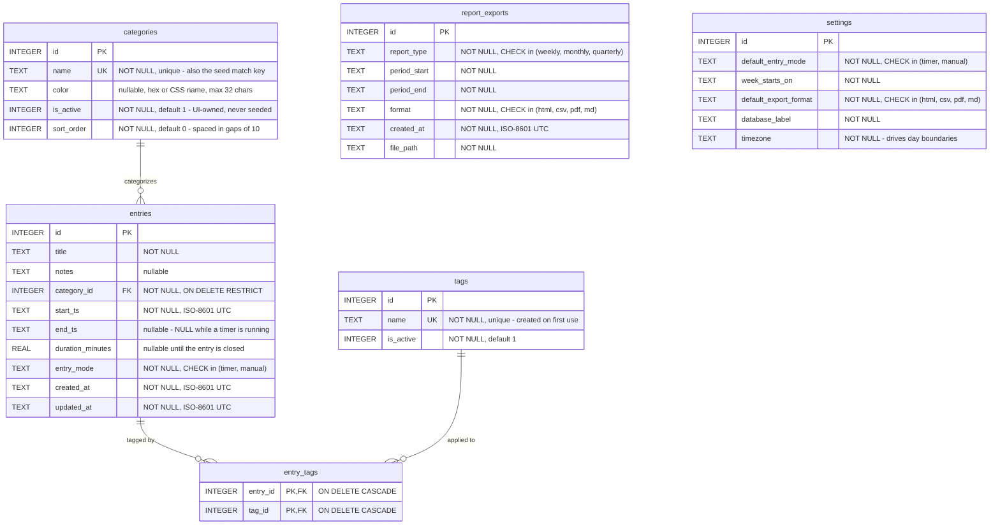

# SCHEMA.md

The SQLite data model of this project. Referenced from [README.md](README.md).

The canonical DDL lives in `app/db_schema.py`, together with the indexes and the idempotent
initialization and migrations. The diagram below is a view of that file. Update both together.

The database holds six tables.

GitHub renders this Mermaid `erDiagram` natively. There is no image to regenerate, and the diff of
a schema change stays readable in a review.

`report_exports` and `settings` stand alone. Neither has a foreign key. `settings` holds exactly
one row, seeded on the first bootstrap by `init_db`.

## Conventions

Read these before you write a query.

- **A timestamp is ISO-8601 TEXT in UTC**, for example `2026-07-13T14:30:00+00:00`. It sorts
  lexicographically in the same order as chronologically, and it survives a CSV or JSON round
  trip. A caller normalizes to UTC on write, and localizes on display with `settings.timezone`.
- **A boolean is an `INTEGER`, 0 or 1.** SQLite has no boolean type.
- **An enum-like column uses a `CHECK` constraint**, not a lookup table. The value sets are small,
  fixed, and defined by the application. A user cannot edit them.
- **Foreign keys are enforced, but only per connection.** Every connection of the application sets
  `PRAGMA foreign_keys = ON`. SQLite defaults it off. An ad-hoc `sqlite3` shell session does not
  get it. Set it yourself before you change any data.

## Indexes

These are the indexes beyond the implicit primary keys and the `UNIQUE` constraints.

| Index | Columns | Serves |
| --- | --- | --- |
| `idx_entries_start_ts` | `entries (start_ts)` | The date-range scans. This is the hottest pattern: Today, Week, Month and Reports. |
| `idx_entries_category_id` | `entries (category_id)` | Filtering time by category, and the foreign-key lookup. |
| `idx_entry_tags_tag_id` | `entry_tags (tag_id)` | The reverse join: every entry with one tag. |

The primary key of `entry_tags` is `(entry_id, tag_id)`. It already indexes `entry_id` first. Only
the reverse direction therefore needs an explicit index.

## Seed data

`seed/categories.toml` holds the categories. `app/seed.py` applies them. The seeding is opt-in: no
category is written on start. `categories.name` is the match key of the seed.

`categories.is_active` and `categories.sort_order` are owned by the interface. The seed never
writes them. `sort_order` is spaced in gaps of 10, so a new category fits between two others
without a renumbering.
